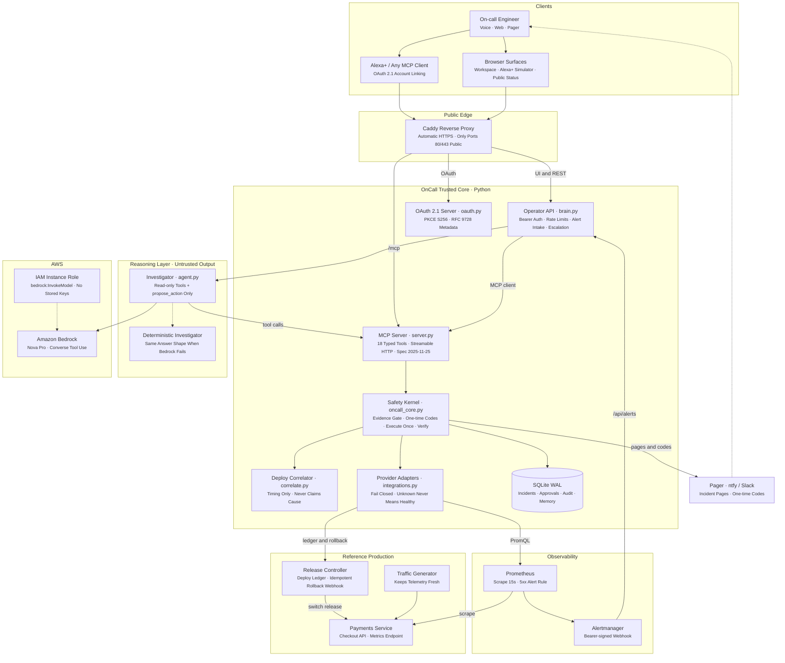
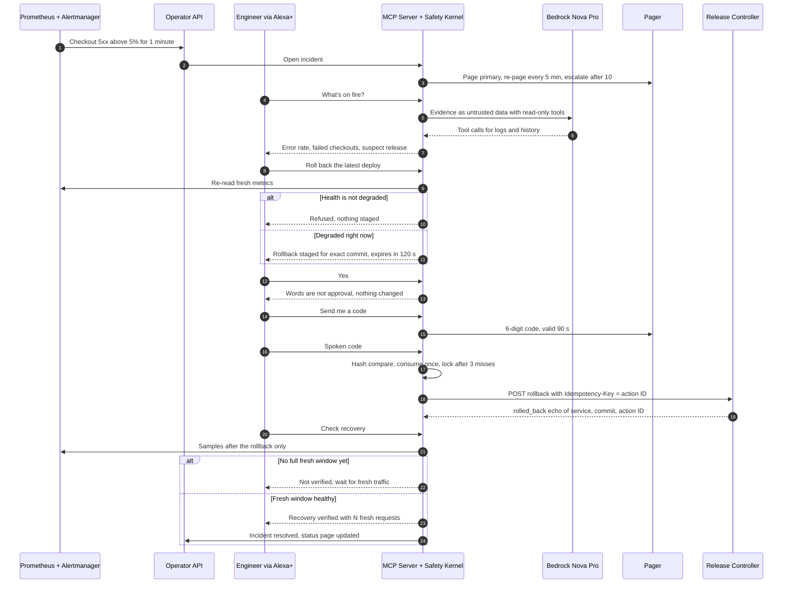
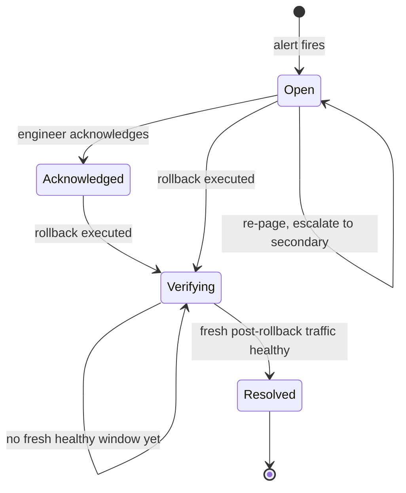
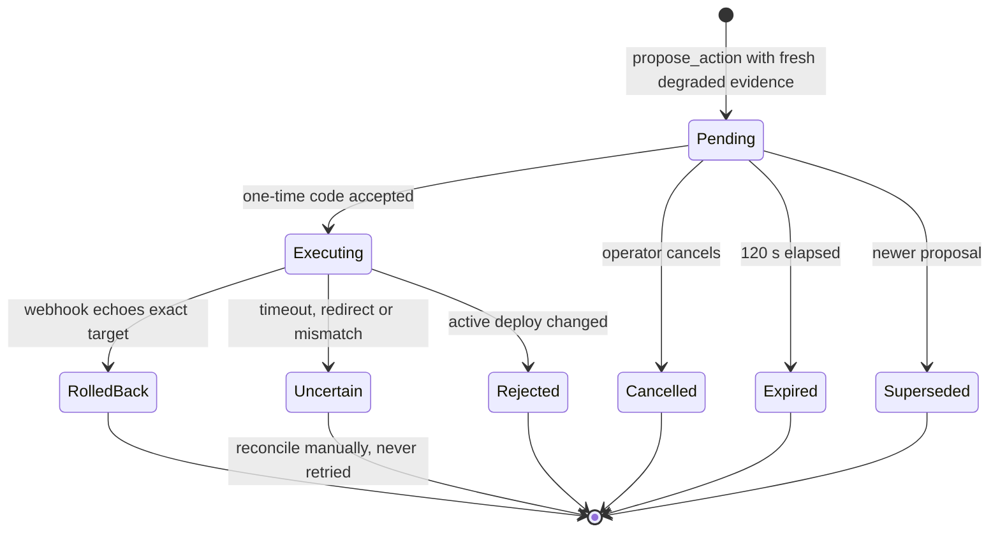
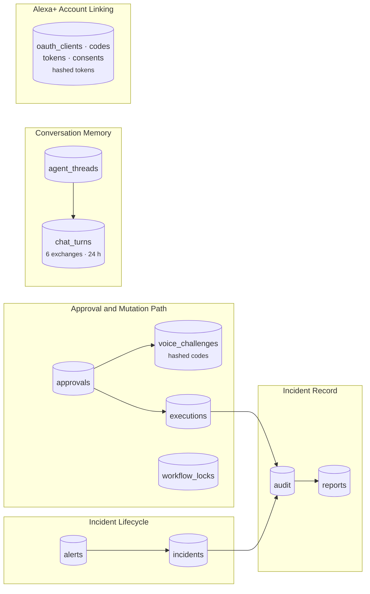
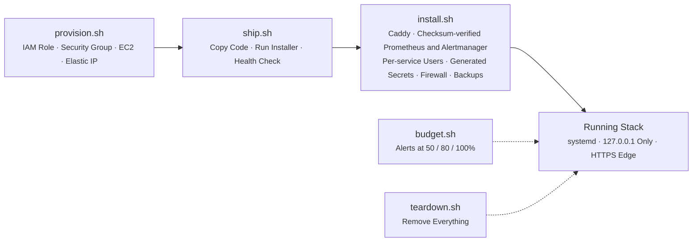

# OnCall architecture

OnCall is an incident agent built around one rule: production changes only with fresh evidence and an out-of-band human approval. The AI model can investigate. It can't decide or act.

## System architecture

Every service binds to `127.0.0.1` and runs as its own system user under systemd (`deploy/systemd/`). Caddy is the only public listener.

The operator API never touches incident data directly. It calls the MCP server as an MCP client (`brain.py` uses the MCP SDK's Streamable HTTP client). So the web workspace, the Alexa+ simulator, the Bedrock agent and a real Alexa+ device all go through the same tools and the same safety checks.

## Components

| Component | File | Responsibility |
| --- | --- | --- |
| MCP server | `server.py` | 18 typed MCP tools, bearer and OAuth gate, Pydantic input validation |
| Operator API | `brain.py` | REST API and UI hosting, command routing, alert intake, re-paging and escalation |
| Investigator | `agent.py` | Bedrock Converse tool use with Nova Pro, conversation memory, deterministic fallback |
| Safety kernel | `oncall_core.py` | Incidents, evidence, proposals, approvals, voice codes, execution, verification, reports, audit |
| OAuth server | `oauth.py` | OAuth 2.1 with PKCE for Alexa+ account linking |
| Correlator | `correlate.py` | Lines up deploy times with error spikes and reports timing, never cause |
| Adapters | `integrations.py`, `config.py` | Prometheus, CloudWatch, GitHub, Loki, deploy ledger, rollback webhook, validated settings |
| Reference production | `production/` | Payments service, release controller, traffic generator |
| Sandbox | `target_service/` | Local fault-injection service for running without a cloud account |

## Incident flow

## State machines

Incident:

Rollback approval:

## Safety guarantees

| Guarantee | How it's enforced |
| --- | --- |
| No action without evidence | `propose_action` re-reads metrics and refuses unless health is `degraded`. Missing, stale or partial telemetry is `unknown`, never `healthy`. |
| The model can't act | Bedrock gets read-only tools plus `propose_action`. Approval and execution tools aren't exposed to it, and tool output is passed as untrusted data. |
| Talking isn't approving | Approval needs a code delivered out of band. Confirmation words are filtered out before any model routing. |
| Codes can't be reused or guessed | Stored as SHA-256 hashes, compared in constant time, consumed under a writer lock, locked after 3 wrong tries, valid 90 seconds. |
| One approval, one target | The approval stores the exact commit. Execution re-checks session, expiry and target, and rejects if the active deploy changed. |
| At most once | Per-deployment execution reservation plus the webhook's durable idempotency key. Uncertain outcomes are consumed, not retried. |
| Recovery is proven | Verification needs a full 2-minute metrics window after the rollback. Pre-rollback traffic counts as zero evidence. |
| Every step is auditable | Each transition writes an audit row, which drives the timeline, the report and the public status page. |

## Data model

SQLite in WAL mode, one database per mode, with a nightly backup installed by `deploy/install.sh`.

## Authentication

| Caller | Credential |
| --- | --- |
| Operator workspace and API | Bearer operator key, constant-time compare |
| MCP clients | Operator key, or an OAuth 2.1 access token whose audience is this server's `/mcp` |
| Alexa+ discovery | `client_credentials` token limited to discovery |
| Alexa+ account link | Authorization code + PKCE `S256` with a static client. The operator approves each link with the operator key. |
| Alertmanager | Dedicated bearer token on `/api/alerts` |
| Deploy ledger and rollback webhook | Separate read and mutation tokens, so a leaked read token can't change production |

Unauthenticated MCP calls get a plain `401` with no `WWW-Authenticate` header, as Alexa+ requires. Rate limits apply per client on every endpoint, including failed key attempts.

## Alexa+ surfaces

- **MCP server (`/mcp`):** what a real Alexa+ add-on connects to. `check_recovery` is non-blocking to fit Alexa's 500 ms tool budget. Manifest template: `deploy/alexa/addon.example.json`.
- **Alexa+ simulator (`/alexa.html`):** a voice and Echo Show style interface that calls the same MCP tools through the operator API. It exists because Alexa+ add-on access isn't open to hackathon participants.

## Integrations

| Purpose | Options | Setting |
| --- | --- | --- |
| Metrics | Prometheus or CloudWatch | `ONCALL_METRICS_SOURCE` |
| Deployments | Release-controller ledger or GitHub Deployments | `ONCALL_DEPLOYS_SOURCE` |
| Logs | Loki (optional) | `ONCALL_LOKI_URL` |
| Rollback | Authenticated webhook (`executor/rollback_executor.py` is a reference) | `ONCALL_ROLLBACK_URL` |
| Paging | ntfy, Slack or JSON webhook, plus an optional secondary | `ONCALL_NOTIFY_URL` |
| Reasoning | Amazon Bedrock Nova Pro, or deterministic | `ONCALL_BEDROCK_MODEL_ID` |

Mutations are off by default (`ONCALL_MUTATION_ENABLED=false`). Every option is documented in `.env.example`.

## Deployment

Secrets are generated on the host into `/etc/oncall/*.env` and never printed. No AWS keys are stored on the server.

## Limitations

- Single operator. It isn't multi-tenant identity.
- SQLite on one host. Scaling out and reconciling interrupted actions need more work.
- A real Alexa+ account link and certification are not yet verified, because the toolkit is partner-only.
